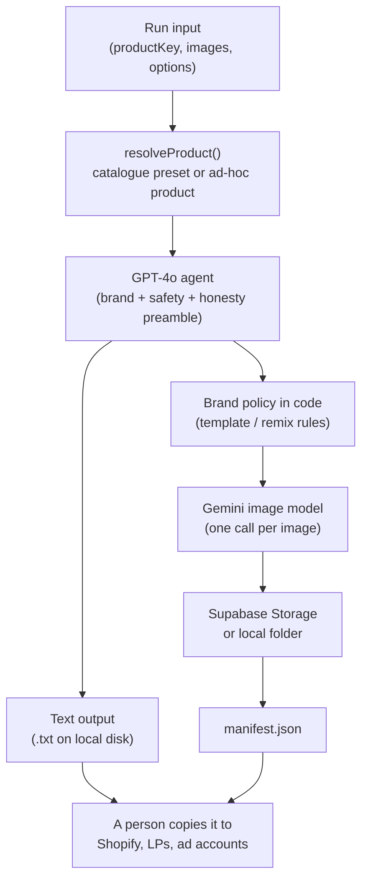

# Overview

This repo generates content for the **AtlasAir** store, which sells home choking-rescue and
emergency-preparedness gear for families. It is a [Mastra](https://mastra.ai/) project: a handful of
AI workflows you run from Mastra Studio, each producing one kind of asset.

It does **not** build landing pages or publish anything to Shopify. It produces the copy, FAQs,
illustrations and ad creatives that people then place on product pages, landing pages and ad
accounts. [Landing pages](landing-pages.md) explains that handoff.

## The five workflows

| Workflow                                             | Produces                                                                     | Models                                     | Lands in                                                  |
| ---------------------------------------------------- | ---------------------------------------------------------------------------- | ------------------------------------------ | --------------------------------------------------------- |
| [`generate-product-copy`](workflows/product-copy.md) | Product title, rich-text description, guarantee/store-policy section         | GPT-4o                                     | `product-copy.txt` on local disk                          |
| [`generate-faqs`](workflows/faqs.md)                 | 3–20 product FAQs                                                            | GPT-4o                                     | `faqs.txt` on local disk                                  |
| [`generate-how-it-works`](workflows/how-it-works.md) | A 4–8 image illustrated "how it works" sequence, text baked into each image  | GPT-4o → Gemini image                      | Supabase Storage (default) or local, plus `manifest.json` |
| [`generate-ad-creatives`](workflows/ad-creatives.md) | Static ad creatives from a catalogue of 40 layout templates                  | GPT-4o picks templates → Gemini image      | Supabase Storage (default) or local, plus `manifest.json` |
| [`remix-creative`](workflows/remix-creative.md)      | Another brand's ad _layout_ rebuilt as an AtlasAir ad, their claims stripped | GPT-4o vision → code policy → Gemini image | Supabase Storage (default) or local, plus `manifest.json` |

GPT-4o is called as `openai/gpt-4o` through Mastra's model router. Every image comes from
`gemini-3.1-flash-image-preview`, called directly with the `@google/genai` SDK.

## How a run flows

Every workflow follows the same shape:

1. **Resolve the product.** `productKey` picks a product from the catalogue in
   [`brand/products.ts`](../src/mastra/brand/products.ts). Alternatively, `productTitle` +
   `productDescription` describe something that isn't in it.
2. **Ask an agent for structured content.** Each agent's instructions open with the same brand,
   safety and honesty preamble from [`brand/prompt-blocks.ts`](../src/mastra/brand/prompt-blocks.ts).
   The agent returns JSON, and the step validates it with zod.
3. **Apply brand policy** (image workflows only). Code, not the model, decides which ad templates may
   be used and which elements of a competitor's ad survive a remix. See
   [Brand and policy](brand-and-policy.md).
4. **Render images.** A `.foreach` step renders up to 3 images at a time and saves each one right
   after it's generated.
5. **Save.** Text workflows write a `.txt`. Image workflows write a `manifest.json` that records
   every file, prompt and input.

## Where things live

| Path                                                                                            | What's there                                                                        |
| ----------------------------------------------------------------------------------------------- | ----------------------------------------------------------------------------------- |
| [`src/mastra/index.ts`](../src/mastra/index.ts)                                                 | Registers workflows, agents and tools; sets up storage and observability            |
| [`src/mastra/workflows/<name>/`](../src/mastra/workflows/)                                      | One folder per workflow: `index.ts` wires the steps, `steps/` holds them            |
| [`src/mastra/agents/`](../src/mastra/agents/)                                                   | The five GPT-4o agents                                                              |
| [`src/mastra/brand/`](../src/mastra/brand/)                                                     | Brand constants, product catalogue, shared prompt blocks, policy rules              |
| [`src/mastra/schemas/`](../src/mastra/schemas/)                                                 | Zod input/output schemas, one file per workflow                                     |
| [`src/mastra/tools/`](../src/mastra/tools/)                                                     | Gemini image generation, image fetch, file write, Supabase upload, template listing |
| [`src/mastra/utils/prompt-creative-mapping.ts`](../src/mastra/utils/prompt-creative-mapping.ts) | The 40 ad-creative templates                                                        |
| [`src/mastra/assets/AdCreatives/`](../src/mastra/assets/AdCreatives/)                           | A sample image for each template, for humans to browse. Never sent to the model     |

## Glossary

- **`productKey`**: one of `atlasair-2`, `atlasair-plus`, `first-aid-kit` or `cpr-course`. It
  fills in the product's title, description, features and type. See
  [Brand and policy → product catalogue](brand-and-policy.md#product-catalogue).
- **Ad-hoc product**: a run with `productTitle` + `productDescription` and no key. It is treated as a
  shippable device with no feature list.
- **`storageDestination`**: `"supabase"` (default) or `"local"`. Applies only to the three image
  workflows; text workflows always write to local disk.
- **Asset root**: the base folder for local output. It comes from `ASSET_OUTPUT_ROOT` and
  defaults to `~/Desktop/AtlasAirAssets`. Set it to an absolute path. See
  [Getting started](getting-started.md#environment-variables).
- **Manifest**: the `manifest.json` written next to the images of a run, listing every file and
  its prompt and timing, plus the full run input.
- **Proof-gated template**: an ad template built around a rating, review or testimonial. It only runs
  when you supply real Judge.me data in `socialProof`.
- **Blocked template**: a template whose premise is deceptive, such as a faux press screenshot.
  These never run.
- **Rebrand / replace** (remix only): with no `productImages`, the competitor's product is kept and
  only its markings change (rebrand). With `productImages`, their product is swapped for yours
  (replace).
- **Element plan** (remix only): the per-text-element keep/replace/drop decision, with a reason for
  each, recorded in the output and manifest.
