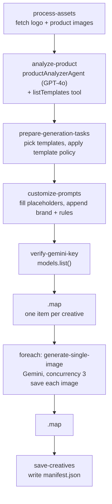

# `generate-ad-creatives`

Generates static ad creatives from a catalogue of 40 layout templates (headline ads, benefit
checklists, comparison grids, review cards and so on). The templates are chosen by an AI analyst or
by hand. Each creative is rendered by Gemini using your logo and product photos as reference images.

Brand policy is enforced **in code** here:

- Deceptive templates are blocked.
- Review-dependent templates only run with real Judge.me data.
- Every prompt ends with a "never invent" rule block.

See [Brand and policy](../brand-and-policy.md).

**Use it for:** paid-social creatives. These go to ad platforms, not product pages.

## Quick start

AI picks five templates:

```json
{
  "productKey": "atlasair-2",
  "logo": "https://cdn.example.com/atlasair-logo.png",
  "productImages": ["https://cdn.example.com/atlasair-2-hero.jpg"],
  "templateSelectionMode": "ai",
  "aiSelectTemplateCount": 5,
  "creativesPerTemplate": 1
}
```

You pick the templates, with real reviews unlocking the proof-gated ones:

```json
{
  "productKey": "atlasair-2",
  "logo": "https://cdn.example.com/atlasair-logo.png",
  "productImages": ["https://cdn.example.com/atlasair-2-hero.jpg"],
  "templateSelectionMode": "manual",
  "templateIds": [5, 27, 17],
  "socialProof": {
    "ratingValue": 4.8,
    "reviewCount": 212,
    "quotes": [
      {
        "text": "Exact review text from Judge.me.",
        "name": "Dana R.",
        "verified": true
      }
    ]
  }
}
```

Only enter Judge.me figures you have copied from the store. The [template catalogue](../ad-template-catalogue.md)
lists every ID and whether it is allowed.

## Inputs

Schema: `generateAdCreativesInputSchema` in
[`schemas/ad-creatives-types.ts`](../../src/mastra/schemas/ad-creatives-types.ts).

| Field                   | Type                                                                         | Default                            | Effect                                                                                                                                      |
| ----------------------- | ---------------------------------------------------------------------------- | ---------------------------------- | ------------------------------------------------------------------------------------------------------------------------------------------- |
| `productKey`            | catalogue key                                                                | —                                  | Fills in the product                                                                                                                        |
| `productTitle`          | string, 1–100                                                                | —                                  | Overrides the preset title                                                                                                                  |
| `productDescription`    | string, 10–10,000                                                            | —                                  | Replaces the generated description                                                                                                          |
| `logo`                  | URL, **required**                                                            | —                                  | Sent to Gemini as reference image 1                                                                                                         |
| `productImages`         | 1–10 URLs, **required**                                                      | —                                  | Sent to Gemini after the logo (14 reference images max)                                                                                     |
| `targetAudience`        | string                                                                       | AI decides                         | Passed to the analyst agent                                                                                                                 |
| `brandTone`             | `professional` \| `playful` \| `luxury` \| `minimal` \| `bold` \| `friendly` | AI decides                         | Passed to the analyst agent                                                                                                                 |
| `brandColors`           | `{ primary, secondary?, accent? }`, `#RRGGBB`                                | AtlasAir palette                   | Overrides colours in the prompt for this run                                                                                                |
| `templateSelectionMode` | `"ai"` \| `"manual"`                                                         | `"ai"`                             | Who picks templates                                                                                                                         |
| `templateIds`           | integers 1–40                                                                | —                                  | Used only when mode is `manual` **and** the list is non-empty. Otherwise the run silently falls back to AI selection                        |
| `aiSelectTemplateCount` | integer 1–20                                                                 | `5`                                | How many templates the AI branch keeps, after policy filtering                                                                              |
| `creativesPerTemplate`  | integer 1–10                                                                 | `1`                                | Variations per template. Variation 2 onward gets a "slight creative differences" instruction                                                |
| `ctaText`               | string                                                                       | `"SHOP NOW"`                       | Fills `[CTA]`                                                                                                                               |
| `socialProof`           | `{ ratingValue?, reviewCount?, quotes? }`                                    | —                                  | Real Judge.me data. Unlocks proof-gated templates and fills rating/quote slots. See [Brand and policy](../brand-and-policy.md#social-proof) |
| `imageGenerationModel`  | string                                                                       | —                                  | **Misnamed.** It doesn't choose a model. A value containing `"4K"` makes images 4K, anything else gives 2K                                  |
| `brandWebsite`          | string                                                                       | —                                  | **Currently has no effect.** No template uses the `[WEBSITE]` placeholder it fills                                                          |
| `outputDirectory`       | string                                                                       | `<asset root>/<title>/<timestamp>` | Local folder. Supabase uses its last two segments                                                                                           |
| `storageDestination`    | `"supabase"` \| `"local"`                                                    | `"supabase"`                       | Where files go                                                                                                                              |

## Steps



1. **`process-assets`** ([step](../../src/mastra/workflows/generate-ad-creatives/steps/process-assets-step.ts))
   - **Fetches** the logo and product images with `processImageInputTool`, using a browser-like
     `User-Agent` because some CDNs block bare server fetches.
   - **Fails** if the logo fails or if every product image fails. If only some product images fail,
     it logs a warning and continues.
   - **Keeps only the URLs.** The base64 is dropped so workflow snapshots stay small, and images are
     fetched again right before generation.
2. **`analyze-product`** ([step](../../src/mastra/workflows/generate-ad-creatives/steps/analyze-product-step.ts))
   - **Asks** `productAnalyzerAgent` ([agent](../../src/mastra/agents/product-analyzer-agent.ts),
     `openai/gpt-4o`) to analyse the product and recommend 10–15 templates.
   - **Template list:** the agent calls its `listTemplates` tool
     ([tool](../../src/mastra/tools/lookup-template.ts)). The tool already hides blocked and
     off-category templates.
   - **Proof flag:** the prompt says whether real Judge.me data was supplied, so the agent doesn't
     recommend review templates that would be dropped.
   - **Output:** `{ keyFeatures, keyMessages, targetAudience, brandTone, visualStyle,
recommendedTemplates[{ templateId, priority, reasoning }], brandAttributes }`.
   - **Always runs**, even in manual mode, because `keyMessages` and `keyFeatures` feed the
     placeholders.
3. **`prepare-generation-tasks`** ([step](../../src/mastra/workflows/generate-ad-creatives/steps/prepare-generation-tasks-step.ts))
   - **Manual mode:** calls `filterTemplates(ids, { strict: true })`.
     - Blocked or off-category IDs **throw**.
     - Proof-gated IDs without `socialProof` are skipped with a warning.
   - **AI mode:** sorts recommendations high → medium → low, filters them by policy, **then** keeps the
     first `aiSelectTemplateCount`.
   - **Tasks:** creates one task per template × `creativesPerTemplate`. Each task takes the
     template's own aspect ratio (1:1, 4:5 or 9:16).
4. **`customize-prompts`** ([step](../../src/mastra/workflows/generate-ad-creatives/steps/customize-prompts-step.ts)).
   Starts from each template's `promptText`, then:
   - **Replaces placeholders** from a fixed map. Each key matches its exact form, `[KEY]`, and the
     same key followed by an example or description: `[KEY — e.g. …]`, `[KEY — the most…]`,
     `[KEY, 3-5 sentences]`, `[KEY like …]`. When a key has a list of values, repeated slots take
     the values in order, as in the rows of a comparison grid. The values come from these sources:

     | Placeholders                                                                                                                          | Source                                                                                       |
     | ------------------------------------------------------------------------------------------------------------------------------------- | -------------------------------------------------------------------------------------------- |
     | Headline / subheadline / hook slots                                                                                                   | `analysis.keyMessages`, falling back to the product title and the brand tagline              |
     | Benefit / callout / strength / icon-label slots                                                                                       | `analysis.keyFeatures`, falling back to the catalogue features                               |
     | Stat slots (`[STAT 1]`…)                                                                                                              | The same features, not numbers. Their paired `[LABEL]` slots are **empty**                   |
     | `[CTA]`                                                                                                                               | `ctaText`, else `"SHOP NOW"`                                                                 |
     | Colour slots                                                                                                                          | The palette, or your `brandColors`                                                           |
     | Rating, quote, reviewer and verified slots                                                                                            | `socialProof` only (the **verbatim** first quote), otherwise **empty**                       |
     | Comparison and before/after slots                                                                                                     | Compare against "being unprepared" and show preparation, never a competitor or a body result |
     | Press quotes, offers, promos, prices, trust badges, endorsements, handles, helpful-vote counts, post metrics, colourway/variant slots | Always **empty**                                                                             |
     | `[DISCLAIMER]`                                                                                                                        | The brand safety disclaimer                                                                  |

   - **Appends the brand visual identity block.**
   - **Appends the ABSOLUTE RULES block:**
     - Never render brackets.
     - Omit any element whose placeholder is empty.
     - Never invent ratings, reviews, names, certifications, urgency or statistics.
     - Render the safety disclaimer as small print.

5. **`verify-gemini-key`** ([step](../../src/mastra/workflows/generate-ad-creatives/steps/verify-gemini-key-step.ts))
   checks that `GOOGLE_API_KEY` exists, is at least 20 characters, and can list models. This runs
   before any paid image call.
6. **`.map`** turns the prompts into self-contained foreach items. Each item carries the reference
   image URLs `[logo, ...productImages]`, the output folder and the size.
7. **`.foreach(generate-single-image, { concurrency: 3 })`** ([step](../../src/mastra/workflows/generate-ad-creatives/steps/generate-single-image-step.ts))
   - Re-fetches the reference images.
   - Calls `generateImageGeminiTool`.
   - Saves the result locally or uploads it to Supabase.
8. **`.map`** collects the creatives.
9. **`save-creatives`** ([step](../../src/mastra/workflows/generate-ad-creatives/steps/save-creatives-step.ts))
   writes `manifest.json`.

**Cost per run:**

- **GPT-4o:** 1 call, plus any `listTemplates` tool round-trips.
- **Gemini:** 1 cheap `models.list` key check, then one image per `templates × creativesPerTemplate`.
  With the defaults that's 5 images.

## Output

Schema: `workflowOutputSchema`.

| Field                     | Contents                                                                                                                                                    |
| ------------------------- | ----------------------------------------------------------------------------------------------------------------------------------------------------------- |
| `success`                 | `true` when the save step finished                                                                                                                          |
| `totalCreativesGenerated` | Number of images                                                                                                                                            |
| `creatives[]`             | `{ templateId, templateName, variationNumber, localPath, prompt, aspectRatio, generatedAt, generationTime, metadata }`. `localPath` is a path or public URL |
| `outputDirectory`         | Local folder, or a non-working `https://supabase.co/storage/…` label in Supabase mode                                                                       |
| `manifestPath`            | Local path or the real public URL of `manifest.json`                                                                                                        |
| `summary`                 | One line                                                                                                                                                    |

**Where files land**

| Destination | Path                                                                                                             |
| ----------- | ---------------------------------------------------------------------------------------------------------------- |
| Supabase    | `<SUPABASE_BUCKET>/<sanitized title>/<timestamp>/<sanitized title>-<Template-Name>-v<n>.<ext>` + `manifest.json` |
| Local       | `<asset root>/<sanitized title>/<timestamp>/…` (same file names) + `manifest.json`                               |

The template part of the file name keeps its case, with spaces and punctuation turned into `-`. For
example: `atlasair-2-0-Bullet-Points-v1.png`. `<ext>` comes from the MIME type Gemini reports, which is
usually PNG.

**Manifest fields:**

- `generatedAt`, `productTitle`, `productDescription`, `totalCreatives`, and `templates` (the unique
  IDs)
- `creatives[]`: every field above, including the **full prompt**
- `input`: the full run input, including `socialProof`

## Retries and failures

`retryConfig: { attempts: 5, delay: 2000 }`: up to 6 attempts per step, and per image.

| Error                                                                         | Cause / fix                                                                                                     |
| ----------------------------------------------------------------------------- | --------------------------------------------------------------------------------------------------------------- |
| `Failed to fetch image from URL (403)…` / `Failed to process logo…`           | The logo or image URL isn't publicly fetchable. Use a CDN/Supabase public URL                                   |
| `Template N is blocked by AtlasAir brand policy: …`                           | You asked for a blocked template in manual mode. Pick another from the [catalogue](../ad-template-catalogue.md) |
| `No templates remain after applying AtlasAir brand policy…`                   | Every selected template was blocked or proof-gated. Add `socialProof` or pick product/educational templates     |
| `GOOGLE_API_KEY environment variable is not set…` / `Invalid GOOGLE_API_KEY…` | Fix the key in `.env`. Note it is retried 5 times first                                                         |
| `Failed to parse agent response: …`                                           | The analyst returned bad JSON. Usually transient, and retries handle it                                         |
| `Failed to upload to Supabase: …`                                             | Supabase env vars, bucket name, or bucket permissions                                                           |
| `Provide either "productKey" …`                                               | No product. Thrown in step 2, **after** the images have been fetched                                            |

One image that still fails after its retries fails the run. Images already uploaded stay in the
bucket, but no manifest is written.

## Things to know

- **The `.webp` files in `assets/AdCreatives/` are never sent to the model.** They are visual
  references for people choosing templates. Gemini only sees your logo and product photos, plus the
  template's text prompt.
- **Layout placeholders are left to the model.** These cover scenes, props, people's hands, colours
  and fonts. Gemini fills them from the reference images and the template's own examples. Every
  truth-bearing slot is filled from real input or emptied first. These are numbers, prices, offers,
  reviews, endorsements, competitor claims and results.
- **Some layouts still don't fit the brand,** such as the food-prop templates. The native/UGC formats
  that showed invented people or posts (8, 20, 29, 32) are blocked. See
  [Known issues](../known-issues.md#some-templates-were-written-for-other-brands).

- **`[BRAND]` and `[YOUR BRAND]` resolve to the product title** ("AtlasAir 2.0"), not "AtlasAir".
- **The choking-device disclaimer and the "being unprepared" comparison are added for every product,**
  including the first aid kit and the course.
- **Retries are generous** (6 attempts), so a persistent Supabase or Gemini error multiplies paid
  calls. Fix configuration errors rather than re-running.
