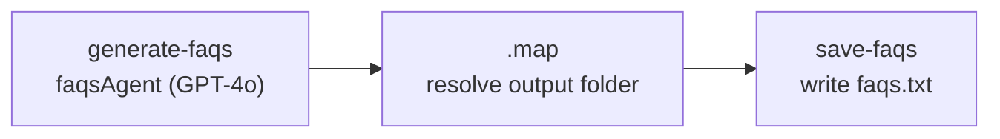

# `generate-faqs`

Writes a set of product-specific FAQs. Buyers of choking-rescue gear ask safety questions, so the
answers are accurate first and reassuring second.

**Use it for:** the FAQ block on product pages and LPs. See [Landing pages](../landing-pages.md).

## Quick start

```json
{ "productKey": "atlasair-2", "faqCount": 8 }
```

## Inputs

Schema: `generateFaqsInputSchema` in [`schemas/faqs-types.ts`](../../src/mastra/schemas/faqs-types.ts).

| Field                | Type              | Default                            | Effect                                                                                          |
| -------------------- | ----------------- | ---------------------------------- | ----------------------------------------------------------------------------------------------- |
| `productKey`         | catalogue key     | —                                  | Fills in the product from the catalogue                                                         |
| `productTitle`       | string, 1–100     | —                                  | Overrides the preset title. Required with `productDescription` when there is no key             |
| `productDescription` | string, 10–10,000 | —                                  | Replaces the generated description                                                              |
| `faqCount`           | integer, 3–20     | `8`                                | How many FAQs to ask for. The model is asked for exactly this many, but the count isn't checked |
| `outputDirectory`    | string            | `<asset root>/<title>/<timestamp>` | Folder for `faqs.txt`                                                                           |

## Steps



1. **`generate-faqs`** ([step](../../src/mastra/workflows/generate-faqs/steps/generate-faqs-step.ts))
   - Resolves the product and prompts `faqsAgent`
     ([agent](../../src/mastra/agents/faqs-agent.ts), `openai/gpt-4o`).
   - Parses a JSON array of `{ question, answer }`.
   - The question mix depends on the product **type**:
     - **Physical** (`device`, `kit`): how it works, who can use it, mask sizing, back blows and
       abdominal thrusts, cleaning and reuse, materials, storage, shipping and returns.
     - **Digital** (`cpr-course`): access, lifetime use, handbook and cards, age-specific protocols,
       what the certificate is and is not, refunds. Shipping is never mentioned.
   - At least one FAQ must ask what the product is **not**. Its answer must say the product is an
     airway-clearance aid, not a substitute for medical care, and that emergency services come first.
2. **`.map`** builds the output folder, the same way as [product copy](product-copy.md#steps).
3. **`save-faqs`** ([step](../../src/mastra/workflows/generate-faqs/steps/save-faqs-step.ts))
   writes `faqs.txt` as a header followed by `Q1:` / `A1:` pairs.

## Output

Schema: `faqsOutputSchema`.

| Field          | Contents                             |
| -------------- | ------------------------------------ |
| `productTitle` | The resolved product title           |
| `faqs`         | `[{ question, answer }]`             |
| `totalFaqs`    | How many the model actually returned |
| `filePath`     | Where `faqs.txt` was written         |

**File:** `<asset root>/<sanitized title>/<timestamp>/faqs.txt`, local disk only. The structured
`faqs` array is only in the run output in Studio. No JSON file is written.

## Retries and failures

`retryConfig: { attempts: 2, delay: 2000 }`: up to 3 attempts per step.

| Error                           | Cause                                                 |
| ------------------------------- | ----------------------------------------------------- |
| `Provide either "productKey" …` | No key and no full ad-hoc product                     |
| `Failed to parse FAQs: …`       | The reply wasn't a JSON array of `{question, answer}` |
| `Failed to write FAQs file: …`  | Output folder not writable                            |

## Things to know

- An **ad-hoc product** (no `productKey`) is always treated as a physical device, so a digital
  product without a key gets shipping questions. Add it to the catalogue instead. See
  [Extending](../extending.md#add-a-product).
- The question mix and the mandatory "what it is not" FAQ are prompt instructions only. Read the
  FAQs before using them.
- The theme's FAQ metafield expects `{ title, description }`, so `question` maps to `title` and
  `answer` maps to `description`. See [Landing pages](../landing-pages.md).
