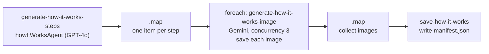

# `generate-how-it-works`

Generates the illustrated step-by-step sequence showing how a product is used. Each step becomes one
image with its label, title and one-line description rendered into it. These images double as
instructions someone might recall under pressure, so they are calm and literal, never dramatic.

**Use it for:** the how-it-works carousel on product pages. See [Landing pages](../landing-pages.md).

## Quick start

```json
{ "productKey": "atlasair-2", "stepCount": 4, "storageDestination": "supabase" }
```

## Inputs

Schema: `generateHowItWorksInputSchema` in
[`schemas/how-it-works-types.ts`](../../src/mastra/schemas/how-it-works-types.ts).

| Field                | Type                                  | Default                            | Effect                                                                                       |
| -------------------- | ------------------------------------- | ---------------------------------- | -------------------------------------------------------------------------------------------- |
| `productKey`         | catalogue key                         | —                                  | Fills in the product                                                                         |
| `productTitle`       | string, 1–100                         | —                                  | Overrides the preset title                                                                   |
| `productDescription` | string, 10–10,000                     | —                                  | Replaces the generated description. More detail gives better steps                           |
| `stepCount`          | integer, 4–8                          | `4`                                | Steps to ask for. Not checked against what comes back                                        |
| `aspectRatio`        | `"1:1"` \| `"9:16"` \| `"4:5"`        | `"1:1"`                            | Image shape                                                                                  |
| `imageSize`          | `"512"` \| `"1K"` \| `"2K"` \| `"4K"` | `"2K"`                             | Image resolution                                                                             |
| `outputDirectory`    | string                                | `<asset root>/<title>/<timestamp>` | Local folder. In Supabase mode only its **last two segments** are used as the storage folder |
| `storageDestination` | `"supabase"` \| `"local"`             | `"supabase"`                       | Where images and the manifest go                                                             |

## Steps



1. **`generate-how-it-works-steps`** ([step](../../src/mastra/workflows/generate-how-it-works/steps/generate-how-it-works-steps-step.ts))
   - Asks `howItWorksAgent` ([agent](../../src/mastra/agents/how-it-works-agent.ts),
     `openai/gpt-4o`) for a JSON array of `{ stepNumber, stepLabel, title, description, visualTheme }`.
   - **Step 1 is always "Call Emergency Services."**
   - Titles are 3–6 word actions. Descriptions are one 8–15 word sentence.
   - `visualTheme` is either a flat medical illustration or a calm domestic scene. It is never a child
     in distress, and never "biotech" CGI.
2. **`.map`**
   - Resolves the output folder, the same way as [product copy](product-copy.md#steps).
   - Fans the steps out into one self-contained item each, carrying the aspect ratio, size, folder
     and destination.
3. **`.foreach(generate-how-it-works-image, { concurrency: 3 })`** ([step](../../src/mastra/workflows/generate-how-it-works/steps/generate-how-it-works-image-step.ts)).
   For each step:
   - **Build the prompt.** It holds the visual theme, the brand `visualIdentityBlock()`, hard
     prohibitions (no distress, no blood, no invented text or badges), and exact text overlays: label
     at the top, title centre-top, description at the bottom.
   - **Call `generateImageGeminiTool`** with no reference images.
   - **Save the result:** write it locally, or upload it to Supabase. In Supabase mode the item's
     `localPath` holds the public URL.
4. **`.map`** collects the images and recovers `originalInput` with `getStepResult`.
5. **`save-how-it-works`** ([step](../../src/mastra/workflows/generate-how-it-works/steps/save-how-it-works-step.ts))
   writes `manifest.json` next to the images. The images were already saved in step 3.

## Output

Schema: `howItWorksOutputSchema`.

| Field                  | Contents                                                                                                                                      |
| ---------------------- | --------------------------------------------------------------------------------------------------------------------------------------------- |
| `success`              | `true` when the save step finished                                                                                                            |
| `totalImagesGenerated` | Number of images                                                                                                                              |
| `images[]`             | `{ stepNumber, stepLabel, title, description, localPath, generatedAt, generationTime, metadata }`. `localPath` is a file path or a public URL |
| `outputDirectory`      | Local: the folder. Supabase: a `https://supabase.co/storage/<bucket>/<folder>` label, **not a working URL**                                   |
| `manifestPath`         | Local path or **real public URL** of `manifest.json`                                                                                          |
| `summary`              | One-line description of the run                                                                                                               |

**Where files land**

| Destination | Path                                                                                                 |
| ----------- | ---------------------------------------------------------------------------------------------------- |
| Supabase    | `<SUPABASE_BUCKET>/<sanitized title>/<timestamp>/<sanitized title>-step-<n>.<ext>` + `manifest.json` |
| Local       | `<asset root>/<sanitized title>/<timestamp>/<sanitized title>-step-<n>.<ext>` + `manifest.json`      |

`<ext>` comes from the MIME type Gemini reports (`png`, `jpg`, …), so it is usually `png`. For
example, an `atlasair-2` run uploads to `AtlasAir/atlasair-2-0/1767000000000/atlasair-2-0-step-1.png`.

**Manifest fields:**

- `generatedAt`, `productTitle`, `productDescription`, `totalImages`
- `images[]`: step fields, plus `fileName`, `fileUrl`, timings and `metadata` (`modelUsed`,
  `visualTheme`)
- `input`: the full run input

## Retries and failures

`retryConfig: { attempts: 3, delay: 2000 }`: up to 4 attempts per step, and per image in the
foreach.

| Error                                                                     | Cause                                                                                |
| ------------------------------------------------------------------------- | ------------------------------------------------------------------------------------ |
| `Failed to parse step content: …`                                         | The agent reply wasn't the expected JSON array                                       |
| `GOOGLE_API_KEY environment variable is required…`                        | No Gemini key. This workflow has no up-front key check                               |
| `No candidates returned from Gemini…` / `No image generated in response…` | Gemini refused or returned only text                                                 |
| `Failed to upload to Supabase: …`                                         | Missing `SUPABASE_URL` / `SUPABASE_SERVICE_ROLE_KEY`, missing bucket, or permissions |
| `Failed to save file locally: …`                                          | Output folder not writable                                                           |

One image that still fails after retries fails the whole run. Images already uploaded stay in the
bucket, but **no manifest is written**.

## Things to know

- **Text is baked into the images.** This suits the store theme's how-it-works carousel. It does
  **not** suit LP galleries whose rule is "photos carry no words". See
  [Landing pages](../landing-pages.md#a-note-on-text-in-images).
- **Image generation and upload happen in the same step**, so a Supabase failure re-runs a paid
  Gemini call on each retry. Check your Supabase env before big runs.
- The file extension and content type follow the MIME type Gemini reports for each image. In
  practice that's usually `.png`.
