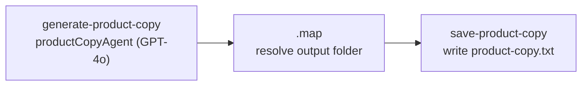

# `generate-product-copy`

Writes a product title, a Shopify-ready rich-text description and a guarantee / store-policy
section for one product. The copy sells readiness for "the 30 seconds before help arrives", not fear.

**Use it for:** the product page title and body in Shopify admin, and the guarantee block on product
pages and LPs. See [Landing pages](../landing-pages.md).

## Quick start

```json
{ "productKey": "atlasair-2" }
```

## Inputs

Schema: `generateProductCopyInputSchema` in
[`schemas/product-copy-types.ts`](../../src/mastra/schemas/product-copy-types.ts).

| Field                | Type              | Default                            | Effect                                                                                                                                                    |
| -------------------- | ----------------- | ---------------------------------- | --------------------------------------------------------------------------------------------------------------------------------------------------------- |
| `productKey`         | catalogue key     | —                                  | Fills in title, description, features and type from [`brand/products.ts`](../../src/mastra/brand/products.ts)                                             |
| `productTitle`       | string, 1–100     | —                                  | Overrides the preset title. Required (with `productDescription`) when there is no key                                                                     |
| `productDescription` | string, 10–10,000 | —                                  | Replaces the generated description entirely. **This is the only way to get a real returns window into the guarantee section.** The agent won't invent one |
| `outputDirectory`    | string            | `<asset root>/<title>/<timestamp>` | Folder for `product-copy.txt`                                                                                                                             |

## Steps



1. **`generate-product-copy`** ([step](../../src/mastra/workflows/generate-product-copy/steps/generate-product-copy-step.ts))
   - Resolves the product.
   - Sends `productBlock(product)` to `productCopyAgent`
     ([agent](../../src/mastra/agents/product-copy-agent.ts), `openai/gpt-4o`).
   - Parses the JSON reply into `{ title, description, guaranteeTitle, guaranteeDescription }`.
2. **`.map`** builds the output folder: `outputDirectory`, or
   `<asset root>/<sanitized title>/<Date.now()>`. The sanitized title is lowercased, with every
   character outside `[a-zA-Z0-9-_]` turned into `-`, so "AtlasAir 2.0" becomes `atlasair-2-0`.
3. **`save-product-copy`** ([step](../../src/mastra/workflows/generate-product-copy/steps/save-product-copy-step.ts))
   writes the text file with `writeFileTool`.

### What the agent is told to write

The description field holds sections B–G of the agent's instructions, in order:

- **B. Opening hook**: five sentences. Names the moment once, then moves on to being equipped.
- **C. How it works**: at least 4 steps. Step 1 is always "Call emergency services."
- **D. What the design does**: at least 3 features, using only feature names that appear in the
  product description.
- **E. Who it's for**: the household, and the age range the product actually supports.
- **F. After the moment**: reuse and storage. For the course: lifetime access instead.
- **G. The honest bit**: mandatory. Says it is an airway-clearance aid, not a substitute for medical
  care or CPR training.

Formatting is plain text with blank lines between paragraphs and an em dash after section and feature
names: no markdown. It is meant to be pasted straight into Shopify's rich-text editor.

The **guarantee section** carries store policy and product facts only. It contains no customer
counts, ratings, statistics, certifications, urgency or invented returns windows. If no returns policy
is supplied, the title is about the policy itself (for example "Our returns policy, in plain
English") and the body says returns follow the store's published policy.

## Output

Schema: `productCopyOutputSchema`.

| Field                  | Contents                               |
| ---------------------- | -------------------------------------- |
| `productTitle`         | The resolved product title (input)     |
| `generatedTitle`       | The new headline title, under 12 words |
| `generatedDescription` | Rich-text body, sections B–G           |
| `guaranteeTitle`       | Guarantee / store-policy headline      |
| `guaranteeDescription` | Guarantee / store-policy body          |
| `filePath`             | Where `product-copy.txt` was written   |

**File:** `<asset root>/<sanitized title>/<timestamp>/product-copy.txt`, local disk only. There is no
Supabase option for this workflow. The file has two labelled sections:
`=== SECTION 1: PRODUCT COPY ===` and `=== SECTION 2: GUARANTEE / SOCIAL PROOF ===`.

## Retries and failures

`retryConfig: { attempts: 2, delay: 2000 }`: each step runs up to 3 times.

| Error                                                                            | Cause                                                               |
| -------------------------------------------------------------------------------- | ------------------------------------------------------------------- |
| `Provide either "productKey" … or both "productTitle" and "productDescription".` | Neither a key nor a full ad-hoc product was given                   |
| `Failed to parse product copy: …`                                                | The model's reply wasn't the expected JSON. The raw reply is logged |
| `Agent returned empty response`                                                  | Empty model response                                                |
| `Failed to write product copy file: …`                                           | The output folder isn't writable                                    |

## Things to know

- The honesty rules here are **instructions to the model**. Nothing in code checks the output.
  Review it before publishing. See [Known issues](../known-issues.md#honesty-rules-in-the-text-workflows-are-prompt-only).
- The file goes under `ASSET_OUTPUT_ROOT`, which defaults to `~/Desktop/AtlasAirAssets`. Set it
  to an absolute path. See [Getting started](../getting-started.md#environment-variables).
