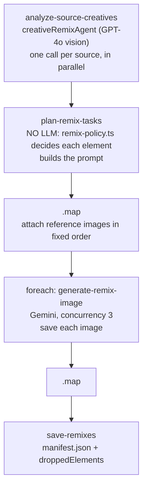

# `remix-creative`

Takes another brand's ad and rebuilds its **layout** as an AtlasAir creative. It keeps the
composition, ad archetype, reading order and aspect ratio. It never takes their copy, colours,
typefaces or logo, and it strips their statistics, badges, reviews and urgency devices before
anything is rendered.

**Use it for:** quickly producing AtlasAir versions of ad formats that are working for competitors.

## Quick start

Same physical product, rebranded in place (the usual case):

```json
{
  "sourceImages": ["https://cdn.example.com/lifeaid-ad.jpg"],
  "sourceBrandName": "LifeAid",
  "productKey": "atlasair-2",
  "logo": "https://cdn.example.com/atlasair-logo.png",
  "variationsPerSource": 2
}
```

## The two modes

The mode depends only on whether you pass `productImages`.

| `productImages` | Mode        | What happens to the product                                                                                                                                                                                                                                                                                                                               |
| --------------- | ----------- | --------------------------------------------------------------------------------------------------------------------------------------------------------------------------------------------------------------------------------------------------------------------------------------------------------------------------------------------------------- |
| Omitted         | **Rebrand** | The source product is kept exactly: form, angle, lighting, materials. Every mark on it is replaced by the AtlasAir logo in the same spot, following the surface curvature. Their symbol (e.g. an arrow) is never recoloured, mirrored or merged with ours. The prompt ends with a sweep for leftover marks in small print, reflections and cropped copies |
| Supplied        | **Replace** | Their product is swapped for yours, rendered from your photography at the same position, scale and crop. Use this when the AtlasAir product actually looks different                                                                                                                                                                                      |

Either way, `layoutFidelity: "loose"` keeps only the archetype and rebuilds the layout in AtlasAir's
own calmer style. The default `"close"` keeps the same zones, sizes and reading order.

## Inputs

Schema: `generateRemixInputSchema` in
[`schemas/remix-creative-types.ts`](../../src/mastra/schemas/remix-creative-types.ts).

| Field                                                | Type                                                 | Default                                  | Effect                                                                                                |
| ---------------------------------------------------- | ---------------------------------------------------- | ---------------------------------------- | ----------------------------------------------------------------------------------------------------- |
| `sourceImages`                                       | 1–10 URLs, **required**                              | —                                        | The ads to remix. They must be fetchable both by OpenAI (vision) and by this server                   |
| `sourceBrandName`                                    | string                                               | —                                        | Helps the vision agent find every one of their marks                                                  |
| `productKey` / `productTitle` / `productDescription` | as other workflows                                   | —                                        | The AtlasAir product featured. Its feature list supplies replacement claims                           |
| `logo`                                               | URL, **required**                                    | —                                        | Reference image 2. The only logo allowed in the output                                                |
| `productImages`                                      | 1–10 URLs                                            | —                                        | Switches to **replace** mode. Reference images 3 and up                                               |
| `brandColors`                                        | `{ primary, secondary?, accent? }`                   | AtlasAir palette                         | Palette override                                                                                      |
| `brandWebsite`                                       | string                                               | —                                        | Replaces a web address **only if the source shows one**. Never adds one                               |
| `ctaText`                                            | string                                               | —                                        | Replaces the source CTA. Without it the source's own CTA wording is kept, and no CTA is added         |
| `socialProof`                                        | Judge.me data                                        | —                                        | Without it, all source social proof is dropped. With it, social proof is **replaced** by your figures |
| `variationsPerSource`                                | integer 1–5                                          | `1`                                      | Remixes per source image                                                                              |
| `aspectRatio`                                        | `1:1` \| `4:5` \| `9:16` \| `3:4` \| `4:3` \| `16:9` | Match each source                        | Force one ratio for all. Every value here is accepted by the image tool                               |
| `imageSize`                                          | `512` \| `1K` \| `2K` \| `4K`                        | `"2K"`                                   | Resolution                                                                                            |
| `layoutFidelity`                                     | `"close"` \| `"loose"`                               | `"close"`                                | How closely to follow the source layout                                                               |
| `outputDirectory`                                    | string                                               | `<asset root>/<title>-remix/<timestamp>` | Local folder. Supabase uses its last two segments                                                     |
| `storageDestination`                                 | `"supabase"` \| `"local"`                            | `"supabase"`                             | Where files go                                                                                        |

## Steps



1. **`analyze-source-creatives`** ([step](../../src/mastra/workflows/remix-creative/steps/analyze-source-creatives-step.ts))
   - **What it does:** sends each source image to `creativeRemixAgent`
     ([agent](../../src/mastra/agents/creative-remix-agent.ts), `openai/gpt-4o`). All sources go at
     once.
   - **Not given the brand voice:** the agent's instructions deliberately leave out the AtlasAir
     voice, so it transcribes the source instead of rewriting it.
   - **Text elements:** it transcribes **every** text element verbatim and classifies each as one of
     `brand-mark`, `product-claim`, `statistic`, `social-proof`, `certification-badge`, `urgency`,
     `competitor-comparison`, `cta` or `structural-label`. When it is unsure, it picks the stricter
     class.
   - **Layout description:** it also describes `adArchetype`, `detectedAspectRatio`, `layout`,
     `visualHierarchy`, `productDepiction`, `logoPlacement`, `productBranding` (every mark on the
     product itself), `sourceColorScheme` and `typographyStyle`.
2. **`plan-remix-tasks`** ([step](../../src/mastra/workflows/remix-creative/steps/plan-remix-tasks-step.ts)). This is **deterministic code with no model call**.
   - **Decisions:** each element goes through `decideElement()` in
     [`brand/remix-policy.ts`](../../src/mastra/brand/remix-policy.ts), which returns keep, replace or
     drop with a reason (the table is in [Brand and policy](../brand-and-policy.md#remix-element-policy)).
   - **Replacement text** depends on the class:

     | Class          | Replaced with                                                              |
     | -------------- | -------------------------------------------------------------------------- |
     | Brand marks    | The product title                                                          |
     | Product claims | The product's own features, rotating so repeated slots get different facts |
     | Social proof   | Your first Judge.me quote or rating text                                   |
     | CTAs           | Kept as in the source unless you pass `ctaText`                            |

   - **Prompt:** `buildRemixPrompt()` assembles:
     - the task framing and the reference image order
     - the layout to rebuild
     - the product section for rebrand or replace mode
     - the logo section
     - the KEEP / REPLACE / OMIT lists
     - the product facts
     - the website rule
     - the absolute content rules, including the safety disclaimer
     - a final check for leftover marks
     - the visual identity block
     - the aspect ratio
   - **Variations:** variation 2 onward may only change crop, lighting and the arrangement of
     secondary elements.

3. **`.map`** attaches `referenceImageUrls` in a **fixed order**:
   `[source ad, AtlasAir logo, ...productImages]`. The prompt refers to them by position ("reference
   image 2" is the logo), so don't reorder them.
4. **`.foreach(generate-remix-image, { concurrency: 3 })`** ([step](../../src/mastra/workflows/remix-creative/steps/generate-remix-image-step.ts))
   fetches the references, calls Gemini, and saves each image.
5. **`.map`** collects the remixes.
6. **`save-remixes`** ([step](../../src/mastra/workflows/remix-creative/steps/save-remixes-step.ts))
   writes the manifest. It also aggregates `droppedElements`, de-duplicated per source.

**Cost per run:**

- **GPT-4o vision:** one call per source.
- **Gemini:** one image per `sources × variationsPerSource`.
- **No key check up front:** a missing Gemini key is only discovered after the vision calls.

## Output

Schema: `remixWorkflowOutputSchema`.

| Field                   | Contents                                                                                                                                         |
| ----------------------- | ------------------------------------------------------------------------------------------------------------------------------------------------ |
| `success`               | `true` when the save step finished                                                                                                               |
| `totalRemixesGenerated` | Number of images                                                                                                                                 |
| `remixes[]`             | `{ sourceUrl, sourceIndex, variationNumber, adArchetype, localPath, prompt, aspectRatio, generatedAt, generationTime, elementPlan[], metadata }` |
| `droppedElements[]`     | `{ sourceUrl, text, classification, reason }` for everything the policy stripped                                                                 |
| `outputDirectory`       | Local folder, or a non-working `https://supabase.co/storage/…` label                                                                             |
| `manifestPath`          | Local path or the real public URL of `manifest.json`                                                                                             |
| `summary`               | One line, including how many elements were stripped                                                                                              |

**Where files land**

| Destination | Path                                                                                                                    |
| ----------- | ----------------------------------------------------------------------------------------------------------------------- |
| Supabase    | `<SUPABASE_BUCKET>/<sanitized title>-remix/<timestamp>/<sanitized title>-remix-<source #>-v<n>.<ext>` + `manifest.json` |
| Local       | `<asset root>/<sanitized title>-remix/<timestamp>/…` (same file names) + `manifest.json`                                |

`<ext>` comes from the MIME type Gemini reports for each image, usually `png`.

**Manifest fields:**

- `generatedAt`, `productTitle`, `sourceBrand`, `sourceImages`
- `remixScope`: what a remix takes and never takes
- `totalRemixes`, `droppedElements`
- `remixes[]`, including each `elementPlan` but **not** the prompt
- `input`: the full run input

The manifest is the audit trail. If someone questions a remix, it shows exactly what was removed from
the source and why.

## Retries and failures

`retryConfig: { attempts: 3, delay: 2000 }`: up to 4 attempts per step, and per image.

| Error                                               | Cause / fix                                                                   |
| --------------------------------------------------- | ----------------------------------------------------------------------------- |
| `Failed to parse source analysis for <url>: …`      | The vision reply wasn't valid. A retry re-runs **every** source's vision call |
| `Vision agent returned an empty response for <url>` | Usually an unreachable or unsupported image URL                               |
| `Invalid result from image generation tool`         | The image tool rejected its input. The run log shows the validation message   |
| `Failed to fetch reference image (403): …`          | The source, logo or product URL blocks server fetches                         |
| `Provide either "productKey" …`                     | No product. Thrown in step 2, after the vision calls                          |
| `GOOGLE_API_KEY environment variable is required…`  | Missing Gemini key                                                            |

## Things to know

- **The source ad must be public to two parties.** OpenAI fetches it for the vision call, and this
  server fetches it for Gemini. Hotlink-protected CDN URLs fail. Re-host the ad in Supabase first.
- **Policy decisions are made in code, not by the model.** The vision agent only observes and
  classifies. Extra protection comes from the "choose the stricter class" rule and from the absolute
  content rules in the image prompt.
- **`REMIX_SCOPE.neverTakes` contradicts rebrand mode.** It says "Any depiction of their product" and
  is appended to every prompt, including rebrand mode, where the prompt otherwise says to reproduce
  the product exactly. See [Known issues](../known-issues.md#remix-scope-text-contradicts-rebrand-mode).
- **Legal review is still yours.** Rebuilding a competitor's layout and reproducing their product
  shape in rebrand mode is a judgement call. The workflow strips their claims and marks, but it can't
  decide whether a particular remix is appropriate to run.
